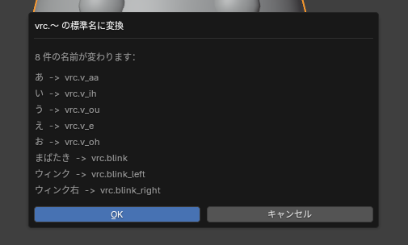

VRoid Studio で作ったモデルを Blender に読み込むと、表情のシェイプキーは `Fcl_MTH_A`・`Fcl_EYE_Close` のような名前になっています。VRChat 向けに口パク（リップシンク）やまばたきを設定するとき、これを `vrc.v_aa`・`vrc.blink` のような VRChat でよく使われる名前にそろえておくと、どのキーがどの口の形かが名前だけで分かります。口の形の `vrc.v_～` は、Unity の VRChat SDK（Avatar Descriptor の Lip Sync）で自動検出が探す名前です。

この記事では、名前を変える方法を3つ書きます。

1. Blender の画面で1つずつ手で変える
2. Python のスクリプトでまとめて変える
3. アドオンでまとめて変える（筆者が作った無料のもの）

1と2だけで用は足ります。

## 前提

- Blender 4.5 LTS／5.1／5.2 で確かめています（5.0 は確かめていません）
- VRoid Studio の出力（.vrm）は、Blender に「VRM Add-on for Blender」などを入れて読み込みます。読み込み方は各アドオンの説明に従ってください
- 作業の前にファイルを別名で保存しておきます

## 対応表

VRoid の名前と VRChat の名前は、次のように対応させます。

| VRoid（Fcl_） | VRChat 名 | 意味 |
|---|---|---|
| Fcl_MTH_A | vrc.v_aa | 口「あ」 |
| Fcl_MTH_I | vrc.v_ih | 口「い」 |
| Fcl_MTH_U | vrc.v_ou | 口「う」 |
| Fcl_MTH_E | vrc.v_e | 口「え」 |
| Fcl_MTH_O | vrc.v_oh | 口「お」 |
| Fcl_EYE_Close | vrc.blink | 両目を閉じる |
| Fcl_EYE_Close_L | vrc.blink_left | 左目を閉じる |
| Fcl_EYE_Close_R | vrc.blink_right | 右目を閉じる |

VRChat の口の形（Viseme）は全部で15個ありますが、VRoid の出力にあるのは「あいうえお」の5つです。残り（`vrc.v_pp`・`vrc.v_ff` など）は、この手順では作りません。名前を変えるだけで、形は変わりません。

まばたきの `vrc.blink` などは公式の決まりではなく、よく使われる慣習の名前です。SDK の Eyelids（まばたき）の設定では、キーを手で指定します。

読み込み方によっては、名前の前に材質の名前が付いて `Face.M_F00_000_00_Fcl_MTH_A` のようになっていることがあります。その場合も、末尾の `Fcl_MTH_A` の部分で上の表を見ます。

## 方法1：画面で1つずつ変える

1. シェイプキーの一覧に `Fcl_MTH_A` などが並ぶメッシュ（多くは Face）を選びます。顔が複数のメッシュに分かれている場合は、一覧を見て確かめます
2. プロパティの「オブジェクトデータ」タブ（緑の三角）を開きます
3. 「シェイプキー」の一覧で、変えたいキーの名前をダブルクリックします
4. 表の右の名前を入力して Enter

8個なら数分で終わります。キーの順番や形は変わりません。いちばん上の `Basis` と、表に無いキー（`Fcl_MTH_Neutral`・`Fcl_BRW_～` など）は変えないでください。

## 方法2：スクリプトでまとめて変える

モデルを何体も直すなら、スクリプトのほうが速く、打ち間違いも減ります。

1. 方法1と同じメッシュを選び、オブジェクトモードにします
2. 「Scripting」タブを開き、「新規」でテキストを作ります
3. 下のコードを貼り付けて「スクリプト実行」（▶）を押します

```python
import bpy

TABLE = {
    "Fcl_MTH_A": "vrc.v_aa",
    "Fcl_MTH_I": "vrc.v_ih",
    "Fcl_MTH_U": "vrc.v_ou",
    "Fcl_MTH_E": "vrc.v_e",
    "Fcl_MTH_O": "vrc.v_oh",
    "Fcl_EYE_Close": "vrc.blink",
    "Fcl_EYE_Close_L": "vrc.blink_left",
    "Fcl_EYE_Close_R": "vrc.blink_right",
}

ob = bpy.context.active_object
keys = ob.data.shape_keys.key_blocks if ob and ob.type == "MESH" and ob.data.shape_keys else None
if keys is None:
    raise RuntimeError("シェイプキーのあるメッシュを選んでください")

def find_new(name):
    # 前に材質名などが付いていても、末尾が表の名前なら当てる（長い名前から先に見る）
    for old in sorted(TABLE, key=len, reverse=True):
        if name == old or name.endswith("_" + old) or name.endswith("." + old):
            return TABLE[old]
    return None

plan = []
for kb in keys[1:]:  # 先頭の Basis は変えない
    new = find_new(kb.name)
    if new and new != kb.name:
        plan.append((kb, new))

# 変えた後に同じ名前が2つできるなら、何も変えずに止める
after = [kb.name for kb in keys]
for kb, new in plan:
    after[list(keys).index(kb)] = new
dup = {n for n in after if after.count(n) > 1}
if dup:
    raise RuntimeError(f"名前が重なるので止めました: {sorted(dup)}")

for kb, new in plan:
    print(f"{kb.name} -> {new}")
    kb.name = new
print(f"{len(plan)} 件を変えました")
if not plan:
    print("変える名前がありません。顔のメッシュ（Fcl_ で始まるキーがあるもの）を選んでいるか、もう変換済みでないかを確かめてください")
```

ポイント：

- `Fcl_EYE_Close_L` が `Fcl_EYE_Close` に先に当たらないよう、長い名前から順に見ています
- 変えた後に名前が重なる場合（例：すでに `vrc.blink` というキーがある）は、何も変えずに止めます。Blender は同じ名前を付けると自動で `.001` を付けるため、気づかないまま進むのを防ぎます
- 1件も変わらないとき（顔以外のメッシュを選んだ・もう変換済み）は、その旨の案内を出して何もしません
- 結果はシェイプキーの一覧で目で確かめます（変えた名前は Windows なら「ウィンドウ」→「システムコンソール切替」でも見られます）。おかしければ、マウスを3D ビューに置いて Ctrl+Z で戻します

MMD 由来の「あ」「まばたき」などの名前も変えたい場合は、`TABLE` に `"あ": "vrc.v_aa"` のように行を足してください。

## 方法3：アドオンでまとめて変える

同じことをボタン1つでやるアドオンを作り、BOOTH で無料で置いています（筆者の作品です）。

- 上の表に加えて、日本語（あ・まばたき 等）・MMD 風・`viseme_aa` 形式の名前も対応表で変換します
- 実行の前に、変わる名前の一覧が出ます。表に無い名前は変えません。名前が重なるときは止めます
- Ctrl+Z で戻せます


*変換の前に出る一覧（Blender 5.2・日本語の画面）*

使い方：3D ビューで N キー →「表情セット」タブ →「vrc.～ の標準名に変換」→ 一覧を見て OK。

https://cocreturn.booth.pm/items/9104250

MMD 風・VRoid など出どころの違うモデルを続けて直すときに手間が減ります。

## まとめ

- VRoid の `Fcl_MTH_A` 〜 `Fcl_EYE_Close_R` の8個は、VRChat の `vrc.v_aa` 〜 `vrc.blink_right` に名前を変えられます
- 数が少なければ画面で手で、何体もあればスクリプトで
- 残りの口の形（`vrc.v_pp` など）は名前の変更では作れません
- 名前を変えた後は、FBX で書き出して Unity の VRChat SDK で設定します。VRM のまま書き出し直すと、VRM 側の表情の割り当てが名前のずれで外れることがあるので、VRM が要る場合は元のファイルを残しておきます

---

※ 非公式の記事です。Blender は Blender Foundation の商標です。VRChat、VRoid、その他の名前は各権利者のもので、この記事とアドオンは各社・各プロジェクトとは関係ありません。アドオンのコードと記事は、生成 AI の支援を受けて作っています。

